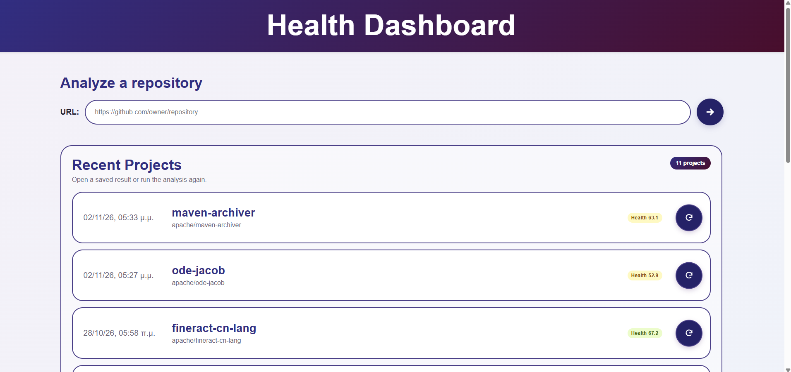
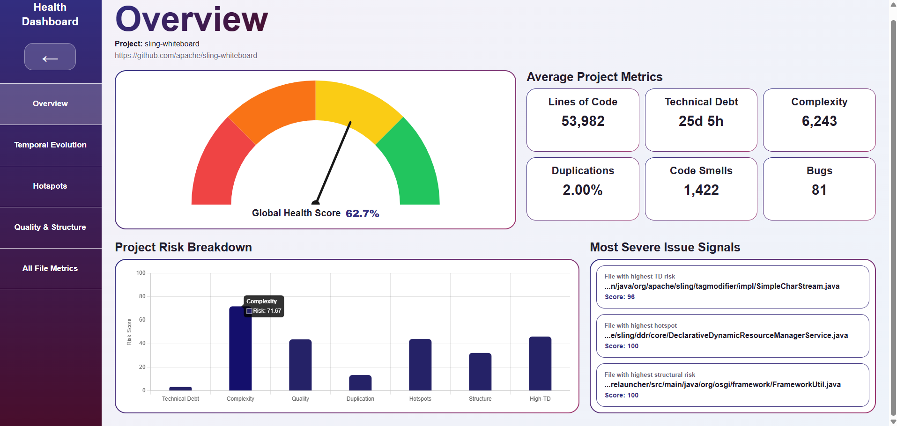
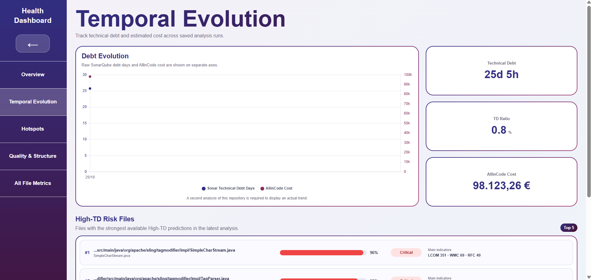
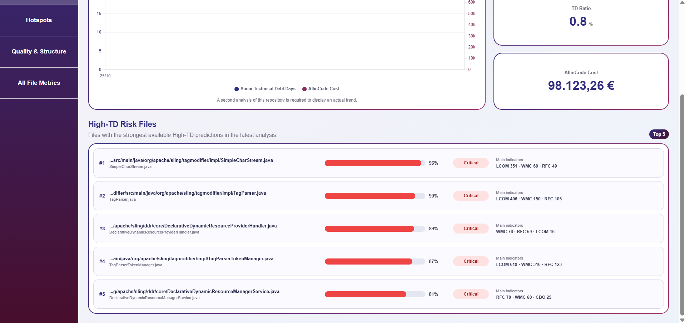
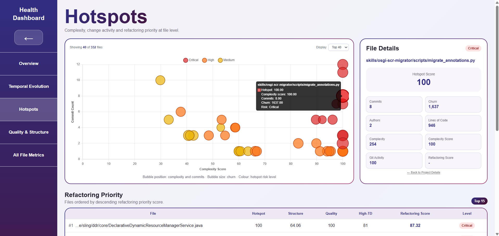
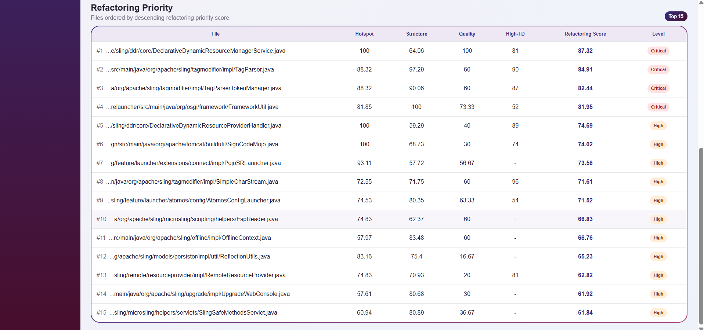
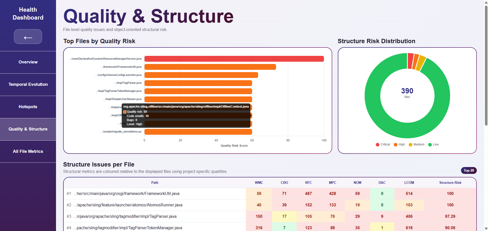
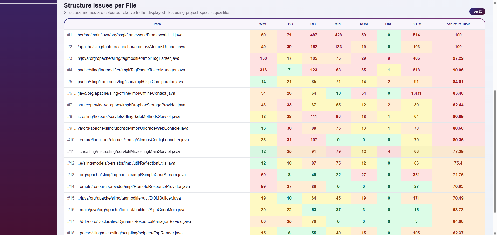
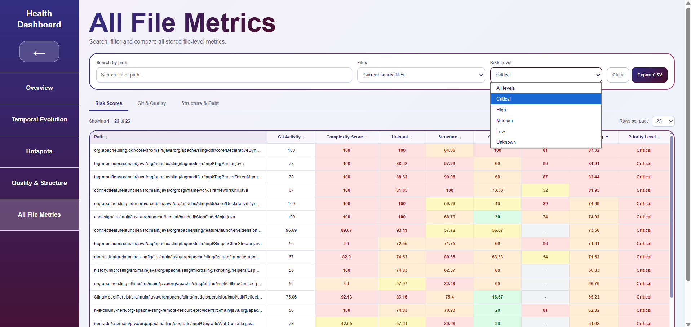

# Code Health Dashboard

An application for analyzing and visualizing software health and technical debt. It combines SonarQube metrics, DEBTclock* data, and Git history, calculates project-level and file-level indicators, and stores analysis results.

Two installation methods are supported:

- **Docker Compose:** local tools and services run in containers.
- **Manual installation on Windows or Linux:** dependencies are installed on the host machine.

*DEBTclock is an external service and requires a valid account and service availability.

## 1. Project Structure

| File / Directory | Description |
| --- | --- |
| `backend/` | Node.js / Express API and analysis services |
| `frontend/` | React / Vite dashboard |
| `processing/` | Python pipeline, scoring, and Git metrics |
| `processing/requirements.txt` | Python dependencies |
| `database/schema.sql` | Database schema without data |
| `database/schema_with_example_data.sql` | Database schema with sample data |
| `backend/Dockerfile` | Backend image and analysis tools |
| `frontend/Dockerfile` | Frontend image |
| `docker-compose.yml` | Service startup and configuration |
| `.env.example` | Root Compose configuration |
| `backend/.env.example` | Backend configuration for manual installation |
| `frontend/.env.example` | Frontend configuration for manual installation |

## 2. Installation with Docker Compose

### Prerequisites

- Windows with Docker Desktop and WSL 2, or Linux with Docker Engine and the Compose plugin.
- A running Docker Engine and an internet connection.
- 16 GB RAM or more is recommended for the full system. Resource usage depends on the repository being analyzed and the resources allocated to Docker.

You do not need to install Node.js, Python, Git, Java, MariaDB, Maven, Gradle, or SonarScanner separately on the host. The backend image includes Node.js 22, Python 3/PyDriller, Git, JDK 21, SonarScanner CLI 8.0.1.6346, Maven, Gradle, and `processing/`.

This Compose setup is intended for local execution and evaluation.

### 2.1 Obtain the Project

Download and extract the ZIP archive. Run Compose commands from the project root, where `docker-compose.yml` is located. The commands work in PowerShell, CMD, and Linux.

### 2.2 Root `.env`

In PowerShell:

```powershell
Copy-Item .env.example .env
```

In CMD:

```cmd
copy .env.example .env
```

In Linux:

```bash
cp .env.example .env
```

Set the following values in the root `.env`:

- `DB_PASSWORD`: a new, non-empty password for the database user.
- `DB_ROOT_PASSWORD`: a new, non-empty password for the MariaDB administrator.
- `ALLINCODE_BASE_URL`, `ALLINCODE_EMAIL`, `ALLINCODE_PASSWORD`: DEBTclock service connection details.
- `SONAR_TOKEN`: leave empty initially; create it in Section 2.5.
- `DB_USER`: choose a username other than `root`. These credentials are for the new Docker database.
- The supplied SQL scripts create the `analyzed_projects` database. Keep `DB_NAME=analyzed_projects` unless you also modify the SQL accordingly.

For SonarQube, the following version is recommended (the Quality Profile instructions also refer to this version):

```dotenv
SONARQUBE_IMAGE=sonarqube:26.10.0.133078-community
```

Use the same value in the root `.env.example`. The generic `sonarqube:community` tag may refer to a different version in the future.

The main Compose addresses are:

```dotenv
DB_HOST=db
SONAR_URL=http://sonarqube:9000
SONAR_SCANNER_HOME=/opt/sonar-scanner
VITE_API_URL=http://localhost:3000
VITE_DEV_HOST=0.0.0.0
```

The backend communicates using the `db` and `sonarqube` service names. `VITE_API_URL` is used by the browser and must be accessible from the user's machine.

The complete Compose setup uses the root `.env`, not the `.env` or `.env.docker` files in subdirectories.

Do not put credentials in `VITE_*` variables, as their values are accessible in the browser.

### 2.3 Linux Host Settings for SonarQube

SonarQube uses Elasticsearch and requires `vm.max_map_count` to be at least `524288`.

**Windows / Docker Desktop with WSL 2:** With Docker Desktop running, use PowerShell or CMD:

```powershell
wsl -d docker-desktop -u root sysctl vm.max_map_count
```

Only if the reported value is below `524288`:

```powershell
wsl -d docker-desktop -u root sysctl -w vm.max_map_count=524288
```

If the value is higher, do not lower it. You may need to apply the change again after restarting WSL/Docker.

**Linux host:**

```bash
sysctl vm.max_map_count
```

Increase it if necessary:

```bash
sudo sysctl -w vm.max_map_count=524288
```

To make the change persistent, add `vm.max_map_count=524288` to a file under `/etc/sysctl.d/` and apply it with `sudo sysctl --system`, unless an appropriate setting already exists.

`fs.file-max` must also be at least `131072`. Compose sets `nofile=131072` and `nproc=8192` for the SonarQube container.

### 2.4 First Startup of the Database and SonarQube

With Docker running, validate the configuration without displaying credentials:

```bash
docker compose config --quiet
```

Start the database and SonarQube:

```bash
docker compose up -d db sonarqube
docker compose ps
```

The first startup may take several minutes. A `health: starting` status indicates that readiness checks are still in progress.

MariaDB automatically imports the selected SQL file through `/docker-entrypoint-initdb.d` **only when initializing an empty volume**. HeidiSQL is not required.

Select one SQL file in the root `.env`:

| Setting | Result |
| --- | --- |
| `SQL_INIT_FILE=./database/schema.sql` | Empty database with the four tables |
| `SQL_INIT_FILE=./database/schema_with_example_data.sql` | Schema and stored sample data |

### 2.5 SonarQube Token

1. Open `http://localhost:9000` once SonarQube is ready.
2. On first startup, sign in with username `admin` and password `admin`, then set a new password.
3. Go to **My Account → Security**.
4. Create a **User Token**, e.g., `codehealth-dashboard`.
5. Copy the token into the root `.env`:

```dotenv
SONAR_TOKEN=your_token_here
```

The token's user must have the permissions required for analysis, project creation, and access to results. A token from another SonarQube installation is not valid on the new server.

### 2.6 Quality Profiles and Differences in Results

Results may vary depending on the SonarQube version, analyzers, Quality Profiles, enabled rules, exclusions, and available build information.

For version **26.10.0.133078**, **Sonar way comprehensive** is recommended for broader rule coverage in the project's languages, such as Java, JavaScript, and Python, where available.

Before the first analysis:

1. Sign in as an administrator and open **Quality Profiles**.
2. Find **Sonar way comprehensive** for the target language.
3. From the profile menu, choose **Set as Default**.
4. For an existing project, go to **Project Settings → Quality Profiles** and verify **Instance default**, or explicitly select the desired profile.

The default is configured separately for each language. Projects with an explicitly assigned profile do not automatically switch when the default changes.

A new analysis is required after changing a profile. Stored dashboard analyses are not recalculated automatically.

The comprehensive profile does not guarantee identical results across versions. For comparisons, record the version, profiles, settings, analysis scope, and commit. Settings are preserved in the SonarQube volumes.

### 2.7 Start the Entire System

After setting the token and configuring the profiles:

```bash
docker compose up -d --build
docker compose ps
```

The backend waits until the database and SonarQube are ready. The frontend waits for the backend health check to pass.

| Service | Address |
| --- | --- |
| Dashboard | http://localhost:5173 |
| Backend / projects | http://localhost:3000/api/projects |
| SonarQube | http://localhost:9000 |

Ports are configured in the root `.env`. MariaDB is accessible internally through the Docker network.

## 3. Subsequent Docker Runs

Start Docker, then run the following from the project root:

```bash
docker compose up -d
docker compose ps
```

Then open the dashboard at `http://localhost:5173`.

Stop the services:

```bash
docker compose down
```

Database data, SonarQube data, and generated results are preserved in volumes. **Do not use `docker compose down -v`** if you want to keep them.

## 4. Manual Installation Without Docker

### 4.1 Required Software

Install:

- Node.js 22.12 or later in the Node.js 22 release line, along with npm.
- Python 3 and Git.
- MariaDB, standalone or through XAMPP.
- A JDK compatible with SonarQube, SonarScanner, and the project being analyzed. The Docker image uses JDK 21.
- SonarQube Community Build and SonarScanner CLI.
- Maven or Gradle, depending on the Java project.
- Optionally, HeidiSQL or another SQL client.

An internet connection and valid DEBTclock credentials are required. Git, Node.js, npm, Java, and the necessary build tools must be available from the command line.

### 4.2 Database and SonarQube

Start MariaDB. If you use XAMPP, click **Start** next to MySQL in the Control Panel.

Connect through HeidiSQL or another SQL client using your installation's connection details, typically host `127.0.0.1` and port `3306`. Open and run **one** of the following files:

- `database/schema.sql`: schema without data.
- `database/schema_with_example_data.sql`: schema with stored sample data.

The SQL scripts create the `analyzed_projects` database and the `projects`, `analysis_runs`, `merged_file_metrics`, and `project_trend_history` tables. You do not need a separate `CREATE DATABASE` statement.

After importing the database, you can close HeidiSQL while keeping MariaDB running.

Start SonarQube. On Windows, run `StartSonar.bat` from the `bin/windows-x86-64/` subdirectory of your installation. Once it is available at `http://localhost:9000`, create a token and configure Quality Profiles as described in Sections **2.5–2.6**.

### 4.3 Environment Configuration

Manual installation uses `backend/.env` and `frontend/.env`, not the root Compose `.env`.

From the project root:

In PowerShell:

```powershell
Copy-Item backend/.env.example backend/.env
Copy-Item frontend/.env.example frontend/.env
```

In CMD:

```cmd
copy backend\.env.example backend\.env
copy frontend\.env.example frontend\.env
```

In Linux:

```bash
cp backend/.env.example backend/.env
cp frontend/.env.example frontend/.env
```

Set the database, SonarQube, and DEBTclock connection details in `backend/.env`. Example local settings:

```dotenv
DB_HOST=127.0.0.1
DB_PORT=3306
DB_NAME=analyzed_projects
PORT=3000
SONAR_URL=http://localhost:9000
PROCESSING_DIR=../processing
RESULTS_DIR=./results
TEMP_DIR=./tmp
```

`SONAR_SCANNER_HOME` points to the scanner installation directory, **not to `bin/` or the `.bat` file**. For example, `C:/tools/sonar-scanner` on Windows or `/opt/sonar-scanner` on Linux. If left empty, the scanner must be available on `PATH`.

Set `PYTHON_CMD` to `python` on Windows or typically `python3` on Linux. It may also be an absolute path to the Python executable, without additional arguments.

Relative `PROCESSING_DIR`, `RESULTS_DIR`, and `TEMP_DIR` paths are resolved relative to `backend/`. To avoid problems with long paths on Windows, use a short path, such as `TEMP_DIR=C:/chd-tmp`.

In `frontend/.env`:

```dotenv
VITE_API_URL=http://localhost:3000
VITE_DEV_HOST=localhost
VITE_DEV_PORT=5173
```

### 4.4 Run the Application

With MariaDB and SonarQube running, open a terminal in the project root:

```bash
cd backend
node server.js
```

You should see `Server listening on port 3000` if `PORT=3000`.

In a second terminal, from the project root:

```bash
cd frontend
npm run dev
```

Open the address displayed by Vite, usually `http://localhost:5173`. Both terminals must remain open. Press **Ctrl+C** to stop the respective process.

## 5. Environment Variables

### Application

| Variable | Description |
| --- | --- |
| `PORT` | Backend port, usually `3000` |
| `DB_HOST`, `DB_PORT` | Database host and port |
| `DB_USER`, `DB_PASSWORD`, `DB_NAME` | Database connection details |
| `SONAR_URL`, `SONAR_TOKEN` | SonarQube URL and token |
| `SONAR_SCANNER_HOME` | Scanner installation directory; leave empty to use `PATH` |
| `SONAR_POLL_INTERVAL_MS` | SonarQube polling interval, `2000` ms |
| `SONAR_ANALYSIS_TIMEOUT_MS` | Timeout for task processing and metric availability after scanning, `120000` ms |
| `ALLINCODE_BASE_URL` | DEBTclock API base URL |
| `ALLINCODE_EMAIL`, `ALLINCODE_PASSWORD` | DEBTclock account credentials |
| `ALLINCODE_POLL_INTERVAL_MS` | DEBTclock polling interval, `5000` ms |
| `ALLINCODE_ANALYSIS_TIMEOUT_MS` | DEBTclock analysis timeout, `86400000` ms / 24 hours |
| `ALLINCODE_STEP_STALL_TIMEOUT_MS` | Maximum time without progress to the next step of a DEBTclock analysis, default `3600000` ms / 1 hour |
| `PYTHON_CMD` | Python executable |
| `PROCESSING_DIR` | Python scripts directory |
| `RESULTS_DIR` | Generated results directory |
| `TEMP_DIR` | Temporary clone directory |
| `VITE_API_URL` | Backend URL as seen by the browser |
| `VITE_DEV_HOST`, `VITE_DEV_PORT` | Vite host interface and port |

### Additional Compose Settings

| Variable | Description |
| --- | --- |
| `COMPOSE_PROJECT_NAME` | Compose project name and volume prefix |
| `BIND_ADDRESS` | Address used to publish ports on the host |
| `BACKEND_HOST_PORT`, `FRONTEND_HOST_PORT`, `SONAR_HOST_PORT` | Host access ports |
| `MARIADB_IMAGE`, `SONARQUBE_IMAGE` | Service images |
| `DB_ROOT_PASSWORD` | MariaDB administrator password |
| `SQL_INIT_FILE` | SQL file used for first-time initialization |
| `SONAR_PORT` | Internal SonarQube port |

## Application Walkthrough

### 1. Home Page

The home page allows users to submit a GitHub repository URL to start a new analysis or access previously analyzed projects.



### 2. Project Overview

The dashboard provides an overview of the project's software health, including key metrics, risk breakdown, and critical issues.



### 3. Temporal Evolution

The temporal evolution section shows how technical debt changes over time, including estimated debt and associated costs.



### 4. High-TD Risk Files

Files with a high probability of technical debt are highlighted alongside their corresponding risk levels.



### 5. Hotspots

The Hotspots view identifies files that combine high complexity and Git activity (hotspots), indicating areas that may require closer attention.



### 6. Refactoring Priority

The Refactoring Priority Score (RPS) is used to rank files in a table and identify potential refactoring candidates.



### 7. Quality & Structure

The Quality & Structure section Highlights files with the highest quality risk scores and shows the distribution of structural risk across files.



### 8. Structural Issues per File

A color-coded table allows users to examine structural metrics and risk scores for individual files.



### 9. All File Metrics

Users can search, filter, and compare detailed file-level metrics across different categories.


